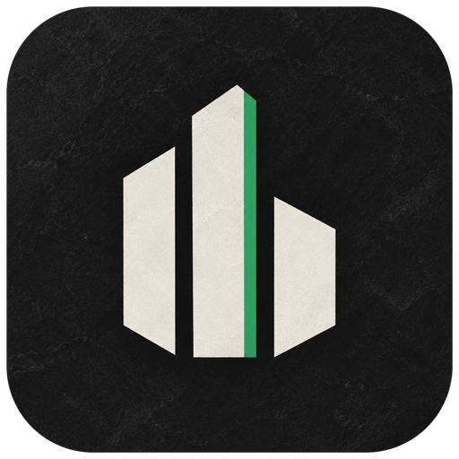
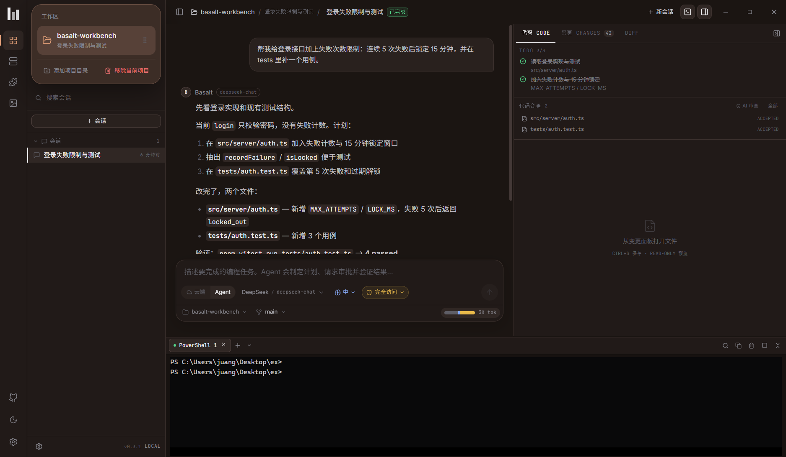
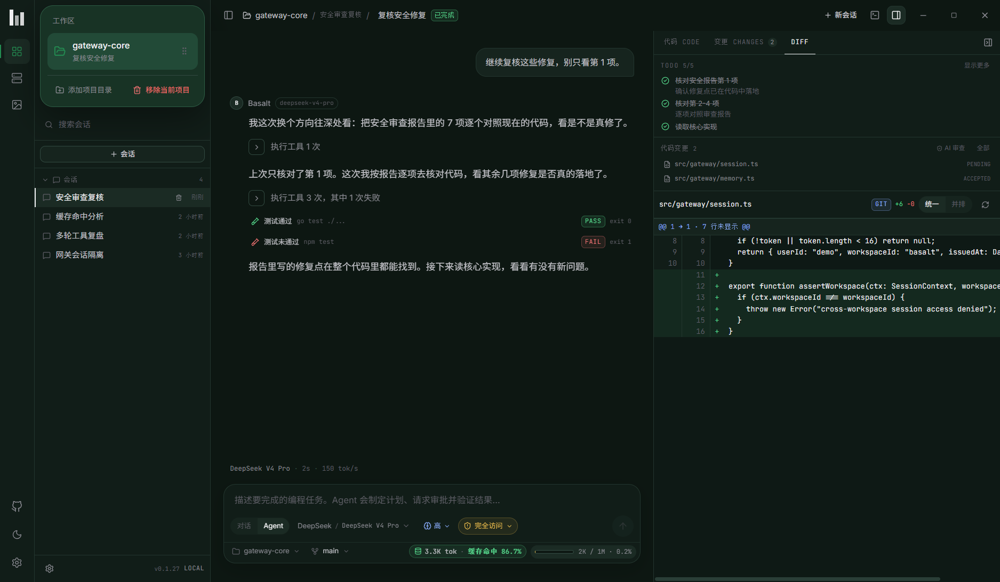
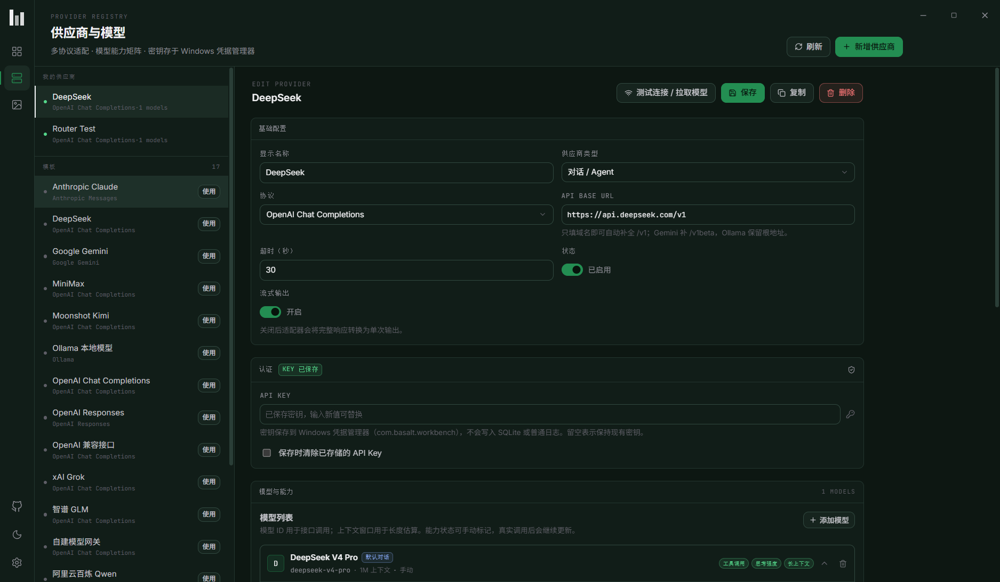
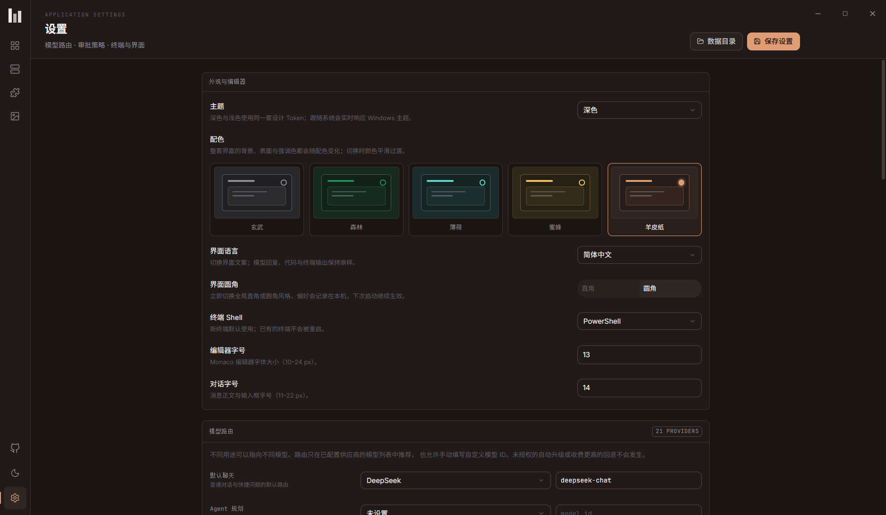
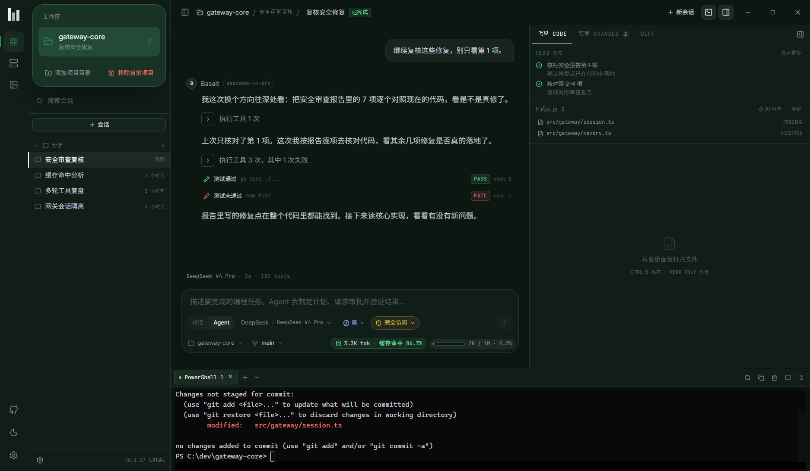
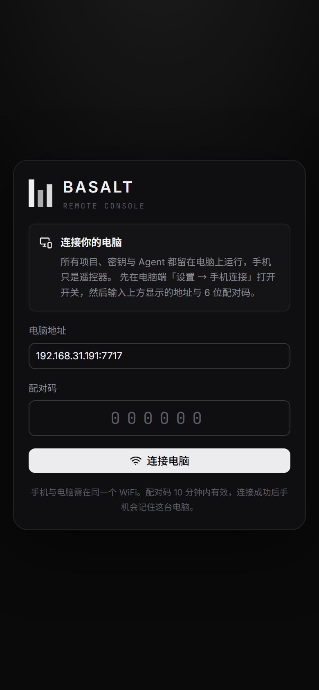
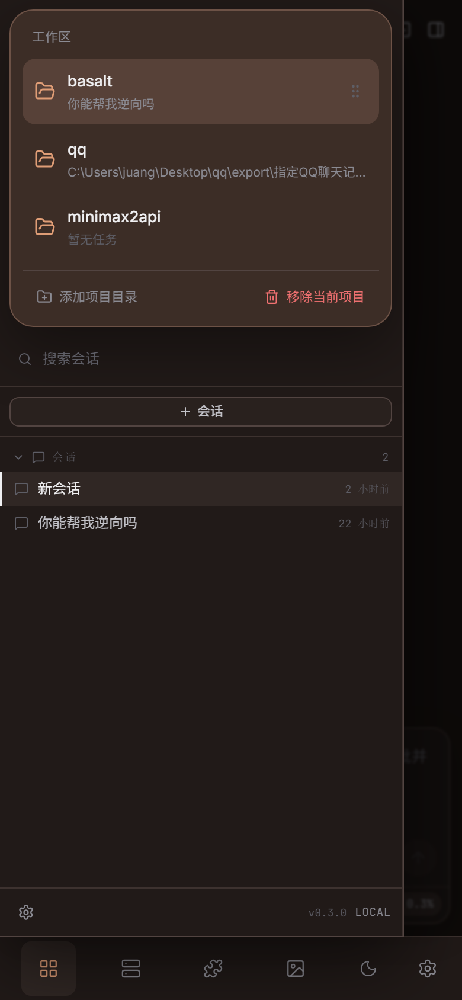

<p align="center">
  
</p>

<h1 align="center">BASALT · 玄武</h1>

<p align="center">
  <strong>本地优先的 AI 工程工作台</strong><br />
  多模型对话 · 审批门控的编程 Agent · 真实终端 · 变更审查 · 图像生成 · 手机接管
</p>

<p align="center">
  
  
  
  
  
  
  
</p>

<p align="center">
  <a href="https://github.com/zakolinxi/basalt-workbench/releases/latest">下载最新版</a>
  ·
  <a href="docs/FEATURES.md">功能清单</a>
  ·
  <a href="docs/REMOTE.md">手机连接</a>
  ·
  <a href="docs/PROVIDERS.md">供应商配置</a>
  ·
  <a href="docs/SECURITY.md">安全说明</a>
</p>

---

Basalt 把 **多模型对话、审批门控的编程 Agent、真实终端、变更审查与图像生成**
放进同一个高密度桌面界面。项目、会话、变更快照和 API Key 都留在本机；
只有你配置的供应商请求，以及 Agent 主动发起的联网工具，会访问外部服务。

从 0.3.0 起，手机可以接管这台工作台：同一 WiFi 下扫码配对，在手机上审批写入与命令、
查看 Diff、跟踪 Agent 进度或直接使用终端。手机不是第二个后端，它连接的是电脑上
正在运行的 **同一个 Basalt**。

## 为什么是 Basalt

- **Agent 优先，但不是演示。** 目标 → 计划 → 工具调用 → 审批 → 修改 → Diff → 测试 → 报告，
  所有展示都来自真实工具事件，不伪造进度；主 Agent 与子代理均不设固定轮次上限。
- **不把你锁在一个模型里。** OpenAI Chat / Responses、Anthropic、Gemini、Ollama 与
  OpenAI 兼容网关都能接入；首次调用后自动探测更低延迟、缓存更友好的接口并持久化。
- **费用可见。** 当前会话的 Token、缓存命中与上下文占用随手可见；DeepSeek / Moonshot
  账户还能直接看到余额与赠送 / 充值构成。
- **本地优先。** SQLite、附件、变更快照和密钥都在本机；Key 保存在 Windows 凭据管理器，
  不进入数据库、配置文件或普通日志。
- **电脑干活，手机接管。** 手机通过局域网连到同一实例，复用同一套界面、后端命令与事件流。

## 功能

### 对话与 Agent

- 流式多轮对话、Markdown / 代码高亮、停止与重试、连续回复合并。
- 图片与文本附件、拖拽导入、`/img` 对话内生图。
- 思考强度 8 档（off / minimal / low / medium / high / xhigh / max / ultra），按会话保存。
- 真实工具：目录、搜索、读写、精确补丁、Git、PowerShell、测试、联网搜索、网页读取。
- 每次写入与命令默认审批；危险命令、路径穿越、项目外绝对路径由策略硬拒绝。
- 工具调用内联到对话轮次，默认折叠；测试结果以 PASS / FAIL 保留。
- 右侧任务面板：TODO、代码变更、子代理任务树与完整报告。
- 规划 / 执行 / 审查模型可分别路由；故障时指数退避重试并可切换降级供应商。
- 任务分支隔离、变更快照、单文件接受 / 撤销与冲突检测。

### 费用与上下文

- 输入框状态栏显示当前会话的 Token 总量与缓存命中率。
- 点击展开缓存读取、未缓存输入、输出与运行上下文占用。
- 上下文条显示已用 / 上限与百分比，展开可见系统提示、消息、工具与输入明细。
- 余额 chip 显示当前供应商账户余额；明细包含赠送、充值与账户可用状态。

### 工作区

- 项目 / 会话侧栏，切换项目或添加目录；点击分支切换或新建本地分支。
- 无边框自定义标题栏、可调整面板、可折叠侧栏与持久化布局。
- 真实 PowerShell / CMD / WSL 终端：多标签、搜索、复制、清屏与进程终止。
- 独立图像工作区：生成、编辑、参考图、蒙版、历史、保存与继续编辑。
- Monaco 编辑器与 Git Diff；变更面板支持提交、还原与冲突提示。

### 手机接管

- 同一 WiFi 下扫码或输入 6 位配对码即可连接；远程访问默认关闭，只监听局域网。
- 手机端复用同一份界面与同一套后端命令：会话、Agent、审批、Diff、终端、供应商、
  Skills / MCP、图像与设置全部可用，不是精简版。
- 与桌面窗口共享同一条事件流：流式回复、工具调用、审批请求与终端输出实时同步。
- Android APK 或浏览器 PWA 两种形态；手机看不到电脑磁盘，添加项目走电脑端目录浏览器，
  附件在手机选取后上传，保存图片改为下载到手机。

### 扩展

- **Skills**：导入包含 `SKILL.md` 的工作流包，Agent 按任务匹配后按需读取。
- **MCP**：stdio 与 Streamable HTTP，自动发现工具、逐次审批、查看 schema 与测试调用。
- **插件包**：一个 `plugin.json` 同时安装多个 Skill / MCP 服务器，卸载时一并清理。
- **统一工具注册表**：集中查看内置工具、Skill 加载器与 MCP 工具及其权限。

### 界面

- 简体中文 / English / 日本語 / 한국어，设置页即时切换。
- 深浅主题 + 5 套整页配色（玄武 / 森林 / 薄荷 / 蜜蜂 / 羊皮纸）。
- 窄屏自适应：手机自动切换抽屉式侧栏、底部导航与全屏终端。
- 常用快捷键与全局搜索。

## 界面截图

### 桌面端

| 工作台 | Agent 与 Diff |
| --- | --- |
|  |  |

| 供应商与模型 | 设置与配色 |
| --- | --- |
|  |  |

<p align="center">
  
  <br />
  <sub>内置 PowerShell：占满宽度、高度自适应上限，xterm 自动 fit。</sub>
</p>

### 手机端

<p align="center">
  
  
  
  <br />
  <sub>配对 → 工作台 → 会话与项目。同一台电脑上的真实数据，经局域网实时同步。</sub>
</p>

## 下载

最新发布页：<https://github.com/zakolinxi/basalt-workbench/releases/latest>

| 文件 | 说明 |
| --- | --- |
| `Basalt.exe` | 免安装 EXE，直接运行 |
| `Basalt_0.3.1_x64-setup.exe` | NSIS 安装包 |
| `Basalt-0.3.1-x64-portable.zip` | 便携包（含 README、LICENSE、OFL） |
| `Basalt-Remote-0.3.1.apk` | Android 手机客户端（release 证书签名） |
| `SHA256SUMS.txt` | 全部发布文件的校验和 |

APK 使用固定的 release 证书签名（`CN=Basalt`，证书 SHA-256
`79:30:0D:C3:2A:04:9E:65…`），后续版本可覆盖安装。Windows 安装包尚未做代码签名，
SmartScreen 可能提示。便携版仍使用 `%APPDATA%\com.basalt.workbench` 保存数据库、附件与设置。

## 快速开始

### 直接使用

1. 打开「供应商」，从模板创建供应商并填入 API Key。
2. Base URL 只填域名即可，保存时自动补全版本路径。
3. 在模型卡片中确认上下文窗口与工具 / 视觉 / 思考能力。
4. 添加本地项目目录，输入任务；Agent 会在授权范围内读取文件、执行命令并请求审批。
5. 输入框底部即可看到当前供应商的余额（若该供应商支持余额接口）。
6. 想用手机接管：设置 → 手机连接 → 打开开关 → 扫码。

### 从源码构建

环境要求：

- Windows 10 / 11 x64 + WebView2 Runtime
- Node.js ≥ 20（本项目在 Node 22 上构建）
- Rust stable（MSVC toolchain）与 Visual Studio Build Tools（C++ 工作负载）
- Git（用于 Diff、分支与 Git 状态）

```bash
npm install
npm run tauri dev      # 开发
npm run tauri build    # 构建 EXE / NSIS 安装包
```

### 手机 APK

需要 JDK 21、Android SDK Platform 35 + Build-Tools 35。

```bash
npm run mobile:apk           # 调试包
npm run mobile:apk:release   # 正式包，使用 release 证书签名
# android/app/build/outputs/apk/release/app-release.apk
```

正式签名读取 `android/keystore.properties`（指向 `~/.basalt/basalt-release.jks`，
两者都不入库）。**重建或更换签名证书会导致无法覆盖安装**，请备份证书与密码。

前端产物与桌面端共用一份：`src-tauri` 通过 `include_dir!` 把它嵌进 exe，
远程网关直接从内存托管，因此电脑端不需要额外部署静态文件。

## 安全

- API Key 保存在 Windows 凭据管理器（`com.basalt.workbench`），不写入 SQLite 或普通日志。
- 余额查询在后端完成，前端只接收余额结果；Key 不会出现在界面、URL 或日志中。
- Agent 写入与命令默认需要批准；危险命令、路径穿越、符号链接逃逸、项目外绝对路径会被策略拒绝。
- 只访问你明确添加的项目目录；变更写入前会创建可审查、可撤销的快照。
- **远程访问默认关闭。** 开启后只监听局域网；必须先看到电脑屏幕上的 6 位配对码才能换取令牌，
  连续猜错 6 次锁定 60 秒；令牌失效即断开并回到配对页。不内置任何公网穿透，
  如需外网请自行加 VPN 或反向代理，并清楚这意味着把整台工作台暴露出去。

## 技术结构

```text
src/                    React 19 + TypeScript 界面（桌面与手机共用）
  components/           聊天、任务、右侧面板、终端、输入框、目录浏览器
  views/                工作台、供应商、图像、扩展、设置、手机配对
  lib/bridge.ts         传输桥：桌面走 Tauri IPC，手机走 HTTP + SSE
  lib/platform.ts       平台差异：文件选择、保存、打开链接
src-tauri/              Tauri 2 + Rust
  src/agent/            Agent Runtime、工具、子代理、系统提示词
  src/providers/        Chat / Responses / Anthropic / Gemini / Ollama 适配器
  src/remote/           远程网关：axum 服务、配对鉴权、RPC 分发、SSE 事件流
  src/commands/         Tauri commands（同一套函数同时服务于桌面与手机）
  src/db.rs             SQLite schema 与迁移
android/                Capacitor Android 工程（手机客户端外壳）
docs/                   功能、设计、手机连接、供应商、测试与截图
```

## 开发验证

```bash
npm test -- --run                                  # 25 项前端测试
cargo test --manifest-path src-tauri/Cargo.toml    # 80 项 Rust 测试
```

当前验证记录见 [docs/TESTING.md](docs/TESTING.md)。

## English

**Basalt** is a local-first Windows AI engineering workbench built with Tauri 2, Rust,
React 19 and SQLite. It combines multi-provider chat, an approval-gated coding Agent,
inline tool activity, a real terminal, change review, and image generation in one
desktop app.

The composer status bar also shows the current provider's account balance, with a detail
popover for total, granted and topped-up credit. The API key is read from Windows
Credential Manager by the Rust backend — it never reaches the UI or logs. DeepSeek and
Moonshot official accounts are supported; gateways without a public balance endpoint
simply hide the entry.

Since 0.3.0 the desktop can be driven from your phone over the local network: pair with a
6-digit code or QR, then approve Agent actions, watch tasks, read diffs and use the terminal
from Android (APK) or any browser (PWA). Projects, keys, the Agent runtime and SQLite never
leave the PC.

The UI ships in Simplified Chinese, English, Japanese and Korean, with per-session
cache/cost telemetry and local credential storage. See
[Releases](https://github.com/zakolinxi/basalt-workbench/releases/latest) to download.

## License & Credits

- Code: MIT License — see [LICENSE](LICENSE).
- Inter / JetBrains Mono: SIL OFL 1.1 — see [src/assets/fonts/OFL.txt](src/assets/fonts/OFL.txt).
- App icon generated with `gpt-image-2.5-sunburst`.
