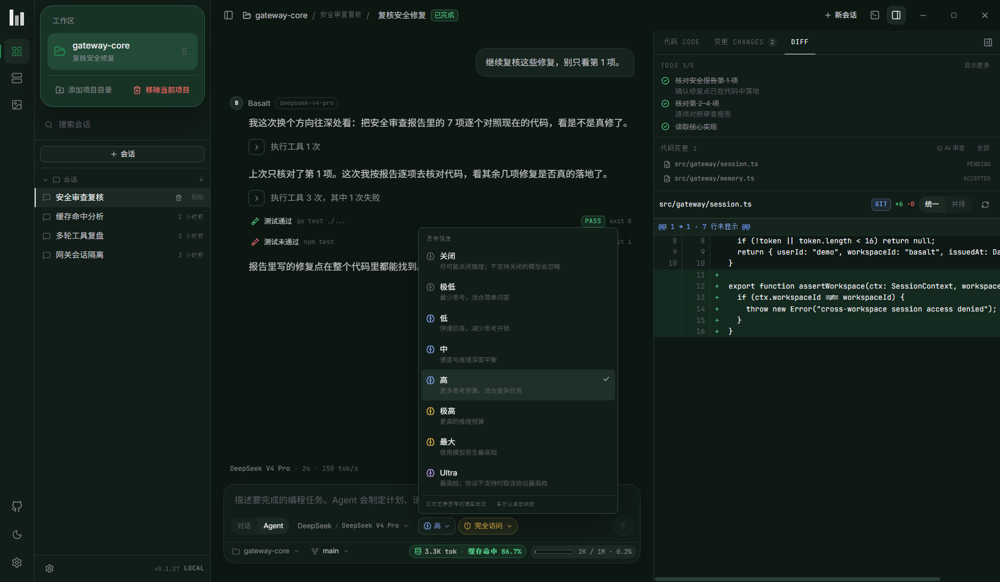
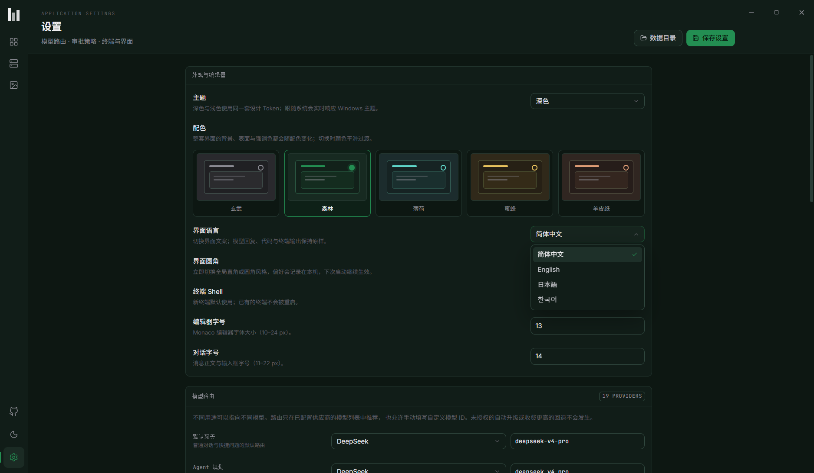

<p align="center">
  
</p>

<h1 align="center">BASALT</h1>

<p align="center">
  <strong>本地优先的 Windows AI 工程工作台</strong><br />
  对话 · Agent · 代码审查 · 真实终端 · 图像生成
</p>

<p align="center">
  
  
  
  
  
</p>

<p align="center">
  <a href="https://github.com/zakolinxi/basalt-workbench/releases/latest">下载最新版本</a>
  ·
  <a href="docs/FEATURES.md">功能清单</a>
  ·
  <a href="docs/DESIGN.md">设计说明</a>
  ·
  <a href="docs/TESTING.md">测试记录</a>
</p>

---

Basalt（玄武）是一个把 **多模型对话、审批门控的编程 Agent、真实终端、变更审查与图像生成**
放进同一个高密度桌面界面的 AI 工程工作台。项目、会话、变更快照和密钥都留在本机；
只有你配置的供应商请求和 Agent 主动发起的联网工具会访问外部服务。

## 为什么是 Basalt

- **Agent 优先，但不是玩具**：目标 → 计划 → 工具调用 → 审批 → 修改 → Diff → 测试 → 报告，
  所有展示都来自真实工具事件，不伪造进度。主 Agent 与子代理均不设固定轮次上限。
- **不把用户锁在一个模型里**：OpenAI Chat / Responses、Anthropic、Gemini、Ollama 与
  OpenAI 兼容网关都能接入；首次调用后自动探测更低延迟、缓存更友好的接口并持久化。
- **费用可见、可控**：缓存命中条按当前会话统计；旧附件不重复发送，工具回传有长度上限，
  Anthropic 只对会复用的前缀启用提示缓存，兼容网关拒绝时自动回退。
- **本地优先**：SQLite + Windows 凭据管理器；密钥不进入数据库、配置文件或普通日志。

## 功能

### Agent 与对话

- 流式多轮对话、Markdown / 代码高亮、停止与重试。
- 连续 Assistant 消息自动合并为一段，只保留首个角色头。
- 工具批次内联在对话轮次中，默认折叠；测试通过/失败以 PASS / FAIL 行保留。
- 回复完成后在输入框上方显示模型、耗时与输出 tok/s；中断/失败/取消可继续。
- 右侧任务栏：TODO 固定在顶部 15% 高度，只显示前三项并可展开全部；代码变更紧随其后。
- 子代理任务树：并行运行的 researcher / planner / reviewer / verifier 独立显示，
  可查看状态、轮次、工具次数与完整报告。
- 思考强度 8 档（off / minimal / low / medium / high / xhigh / max / ultra），按协议映射。
- 缓存命中、未缓存输入、缓存读取、输出与运行的上下文占用随手可见。

### 协作、恢复与扩展

- 多 Agent 协作：主 Agent 可一次并行调度最多 6 个只读专业子代理，再汇总结果完成修改。
- 规划 / 执行 / 审查模型可分别路由；reviewer 与自动审查使用独立代码审查模型。
- 故障恢复：瞬时网络、429 与 5xx 自动指数退避重试；主供应商失败时可切换到已配置的降级供应商。
- Skills：导入包含 `SKILL.md` 的工作流包，Agent 按任务匹配读取说明、脚本与模板后执行。
- MCP：支持 stdio 与 Streamable HTTP，自动发现工具、逐次审批、查看 schema 并直接测试调用。
- 插件包：一个 `plugin.json` 同时安装多个 Skill 与 MCP 服务器，卸载时一并清理。
- 统一工具注册表：集中显示内置工具、Skill 加载器与所有已启用 MCP 工具及其权限。
- Git 工作流：任务分支隔离、工作区提交、单文件还原到 HEAD、合并冲突提示。
- 多项目并行：每个项目拥有独立 Agent 队列，不同工作区可同时运行，同一项目保持串行安全。

### 多模型与自动接口

- 内置模型接口库：按模型家族给出推荐协议、成本档、速度档与来源。
- 首次真实调用后自动探测 Chat / Responses 端点，选择低延迟且缓存友好的接口。
- 供应商模型卡片支持上下文窗口、10 项能力状态、默认模型与手动接口检测。
- Base URL 自动补全：OpenAI `/v1`、Gemini `/v1beta`、Ollama 根地址。

### 工作区

- 无边框自定义标题栏，可拖动、双击最大化，窗口按钮与面包屑同一行。
- 会话式侧栏，点击项目名切换工作区或添加目录，点击分支切换 / 新建 Git 分支。
- 真实 PowerShell / CMD / WSL 终端，多标签、搜索、复制、清屏与进程终止；
  终端占满可用宽度，默认高度克制，xterm 自动适配。
- 独立图像工作区：生成、编辑、参考图、蒙版、历史、保存与继续编辑。

### 界面

- 简体中文 / English / 日本語 / 한국어，设置页即时切换并持久化。
- 深浅主题、5 套整页配色（玄武 / 森林 / 薄荷 / 蜜蜂 / 羊皮纸）、460ms 颜色过渡。
- 森林配色使用 DULUX 90GY 21/472「绿林山居」`#238E52`。
- 下拉框统一使用应用内自定义菜单，不再出现原生浏览器弹层。
- 首屏按需加载：Monaco、xterm、设置/供应商/图像视图均动态加载，主入口约 0.82 MB。

## 界面截图

| 工作台 | Agent 与 Diff |
| --- | --- |
|  |  |

| 思考强度 | 供应商与模型 |
| --- | --- |
|  |  |

| 设置与配色 | 四语言切换 |
| --- | --- |
|  |  |

<p align="center">
  
  <br />
  <sub>内置 PowerShell：占满宽度、高度自适应上限，xterm 自动 fit。</sub>
</p>

## 快速开始

### 环境

- Windows 10 / 11 x64 + WebView2 Runtime
- Node.js ≥ 20（本项目在 Node 26 上构建）
- Rust stable（MSVC toolchain）与 Visual Studio Build Tools（C++ 工作负载）
- Git（用于 Diff、分支与 Git 状态）

### 开发

```bash
npm install
npm run tauri dev
```

### 构建

```bash
npm run build
npm run tauri build
```

## 下载

最新发布：<https://github.com/zakolinxi/basalt-workbench/releases/latest>

- `Basalt.exe` — 免安装 EXE
- `Basalt_0.2.2_x64-setup.exe` — NSIS 安装包
- `Basalt-0.2.2-x64-portable.zip` — 便携包（含 README、LICENSE、OFL）
- `SHA256SUMS.txt` — 校验和

安装包未签名，Windows SmartScreen 可能提示。便携版仍使用
`%APPDATA%\com.basalt.workbench` 保存数据库、附件与设置。

## 首次使用

1. 打开「供应商」，从模板创建供应商并填写 API Key。
2. Base URL 只填域名即可，保存时自动补全版本路径。
3. 在模型卡片中确认上下文窗口与工具 / 视觉 / 思考能力。
4. 添加本地项目目录，输入任务；Agent 会在授权范围内读取文件、执行命令并请求审批。
5. 在「设置」中切换主题、配色与界面语言。

## 安全

- API Key 保存在 Windows 凭据管理器（`com.basalt.workbench`），不写入 SQLite 或普通日志。
- Agent 写入与命令默认需要批准；危险命令、路径穿越、符号链接逃逸、项目外绝对路径会被策略拒绝。
- 只访问你明确添加的项目目录；变更写入前会创建可审查、可撤销的快照。

## 技术结构

```text
src/                    React 19 + TypeScript 界面
  components/           聊天、任务、右侧面板、终端、输入框
  views/                工作台、供应商、图像、设置
  lib/                  状态、API、i18n、主题、Diff
src-tauri/              Tauri 2 + Rust
  src/agent/            Agent Runtime、工具、子代理、系统提示词
  src/providers/        Chat / Responses / Anthropic / Gemini / Ollama 适配器
  src/commands/         Tauri commands
  src/db.rs             SQLite schema 与迁移
docs/                   功能、设计、供应商、测试与截图
```

## 开发验证

```bash
npm test -- --run                 # 23 frontend tests
cargo test --manifest-path src-tauri/Cargo.toml   # 62 Rust tests
```

当前验证记录见 [docs/TESTING.md](docs/TESTING.md)。

## English

**Basalt** is a local-first Windows AI engineering workbench built with Tauri 2, Rust,
React 19 and SQLite. It combines multi-provider chat, an approval-gated coding Agent,
inline tool activity, a real terminal, change review, and image generation in one
desktop app. The UI ships in Simplified Chinese, English, Japanese and Korean, with
per-session cache/cost telemetry and local credential storage. See
[Releases](https://github.com/zakolinxi/basalt-workbench/releases/latest) to download.

## License & Credits

- Code: MIT License — see [LICENSE](LICENSE).
- Inter / JetBrains Mono: SIL OFL 1.1 — see [OFL.txt](OFL.txt).
- App icon generated with `gpt-image-2.5-sunburst`.
