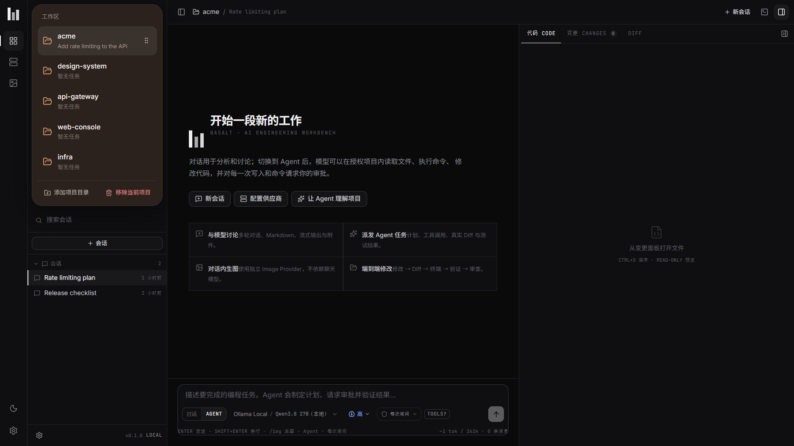
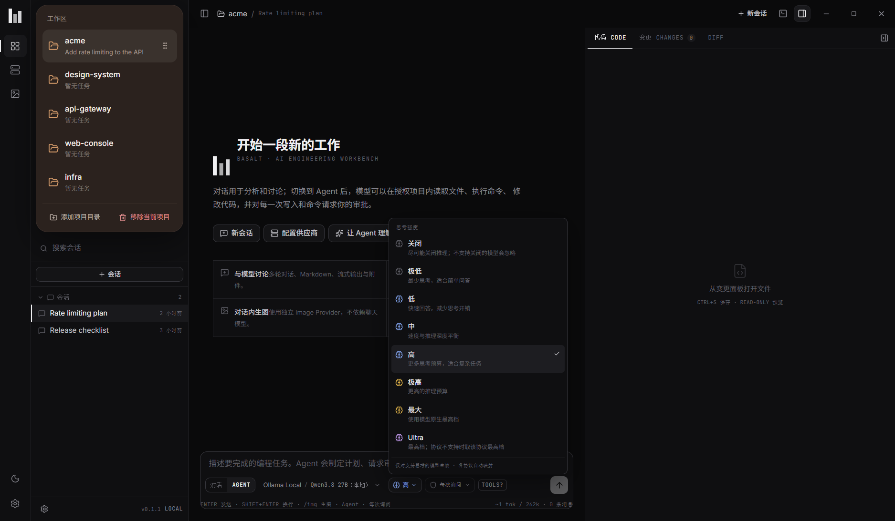
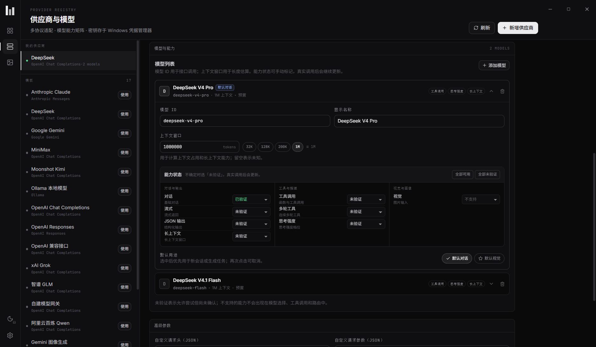
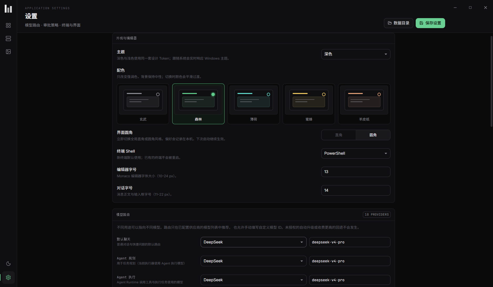

# BASALT

**Basalt** 是一个本地优先的 Windows AI 编程工作台。它将多轮对话、审批门控的编程 Agent、
真实终端、文件变更审查与独立图像生成整合到一个高密度桌面界面中。

GitHub：<https://github.com/zakolinxi/basalt-workbench>  
下载最新版本：<https://github.com/zakolinxi/basalt-workbench/releases/latest>

- 品牌：BASALT / 玄武
- 定位：AI Engineering Workbench
- 技术栈：Tauri 2 · Rust · React 19 · TypeScript · Vite · SQLite · Monaco · xterm.js
- 平台：Windows 10/11（WebView2）

## 核心能力

- **多供应商、多协议**：OpenAI Chat Completions、OpenAI Responses、Anthropic Messages、
  Google Gemini、Ollama、OpenAI 兼容接口与自定义网关；协议适配器、Agent Runtime、
  Image Provider 三层解耦。模板内置当前主力模型的上下文、视觉与工具预设，并支持
  统一选择思考强度（off / minimal / low / medium / high / xhigh / max / ultra），
  按协议自动映射。
- **Agent 编程闭环**：目标 → 计划 → 工具调用 → 审批 → 文件修改 → Diff → 终端测试 →
  失败修复 → 报告。内置联网搜索、网页读取与只读子代理；所有展示都来自真实工具事件，
  不使用伪造进度。
- **审批与安全**：写入与命令默认等待批准；路径穿越、符号链接逃逸、危险命令、编码载荷、
  注册表 / 提权 / 磁盘操作会被策略拒绝。API Key 存储在 Windows 凭据管理器。
- **真实变更审查**：每次 Agent 写入生成变更快照；支持统一 / 并排 Diff、单文件接受、
  撤销与冲突检测。Git 状态与 HEAD 对比独立于任务快照。
- **真实终端**：PowerShell / CMD / WSL，多标签、实时输出、退出码、搜索、复制、清屏、
  终止进程。用户命令与 Agent 命令来源清晰区分。
- **独立图像工作区**：生成、编辑、参考图、能力约束的参数面板、历史、保存、重生成、
  继续编辑；对话内 `/img` 使用独立 Image Provider，不要求聊天模型具备生图能力。
- **本地优先**：项目、会话、变更快照与密钥都留在本机；只有你配置的供应商请求和
  Agent 主动发起的联网工具调用会访问外部服务。

## 快速开始

环境要求：

- Windows 10/11 x64，WebView2 Runtime
- Node.js ≥ 20（本项目在 Node 26 上构建）
- Rust stable（MSVC toolchain）与 Visual Studio Build Tools（C++ 工作负载）
- Git（用于 Diff 与 Git 状态）

```bash
npm install
npm run tauri dev
```

生产构建：

```bash
npm run build
npm run tauri build
```

本机已验证产物（见 `release/`）：

- `release/Basalt.exe` — 免安装 EXE
- `release/Basalt_0.1.2_x64-setup.exe` — NSIS 安装包（7.55 MiB）
- `release/Basalt-0.1.2-x64-portable.zip` — 便携压缩包
- `release/SHA256SUMS.txt` — 校验和

原始构建位置：`src-tauri/target/release/basalt.exe`、
`src-tauri/target/release/bundle/nsis/`。安装包未签名，Windows SmartScreen 可能提示。

### 首次使用

1. 打开「供应商」，从模板创建供应商（OpenAI、Anthropic、Gemini、DeepSeek、MiniMax、
   Kimi、Qwen、GLM、Grok、Ollama 或兼容接口）。
2. 填写 API Key、Base URL，保存并「测试连接 / 拉取模型」。
3. 在模型能力矩阵中确认或手动标记能力；真实调用成功后能力会自动标记为已验证。
4. 在「设置 → 模型路由」中选择默认聊天、Agent 执行、代码审查、图像生成与编辑模型。
5. 添加本地项目目录，输入框默认处于 **Agent** 模式，输入任务即可开始。
6. 使用 `/img <提示词>` 可在对话内调用独立图像供应商。

API Key 只写入 Windows 凭据管理器；数据库与前端均不保存明文密钥。

## 界面预览

| 工作台 | 思考强度 |
| --- | --- |
|  |  |
| 工作区 + 会话侧栏、默认 Agent 输入框 | off / minimal / low / medium / high / xhigh / max / ultra |
| 供应商与模板 | 模型路由 |
|  |  |
| 供应商、模板与模型能力矩阵 | 模型路由与 Agent 设置 |

截图使用本地 Ollama 供应商与演示工作区，不包含真实 API Key、项目代码或个人路径。

## 项目结构

```
src/                         React 前端
  components/                工作台、聊天、时间线、Diff、终端、供应商表单等
  views/                     Workbench / Providers / ImageStudio / Settings
  lib/                       API 封装、Zustand store、类型、Diff 工具、Monaco 配置
src-tauri/                   Rust 后端
  src/providers/             多协议对话与图像适配器
  src/agent/                 Agent Runtime、工具、系统提示
  src/commands/              Tauri 命令边界
  src/changes.rs             变更快照、接受 / 撤销与冲突检测
  src/terminal.rs            ConPTY 终端管理
  src/db.rs / secrets.rs     SQLite 与 Windows 凭据存储
  src/events.rs              任务事件总线（SQLite + Tauri Events）
docs/                        架构、设计、安全、测试与资源记录
```

## 文档

- [模块架构与协议适配](docs/ARCHITECTURE.md)
- [供应商接入指南](docs/PROVIDERS.md)
- [图像生成与编辑](docs/IMAGES.md)
- [设计系统](docs/DESIGN.md)
- [安全与权限模型](docs/SECURITY.md)
- [开发环境、Skills 与资源检查记录](docs/SKILLS.md)
- [自动化测试与验证记录](docs/TESTING.md)
- [功能完成度与已知限制](docs/FEATURES.md)

## 验证命令

```bash
npx tsc --noEmit
npx vitest run
cd src-tauri && cargo test
```

界面验证使用隔离的 `identifier` 启动开发实例，并通过 WebView2 调试端口检查
真实交互与请求体；详见 [TESTING.md](docs/TESTING.md)。

## 安全提示

- Basalt 通过审批、路径校验和危险命令策略限制 Agent，但系统 Shell 本身不是操作系统级沙箱。
  请只在可恢复的本地项目中启用自动批准。
- 普通聊天不会执行命令或修改文件；所有副作用都发生在明确选择的 Agent 任务中。
- 图片远程 URL 下载仅允许 HTTPS，并拒绝本地 / 内网解析结果。
- 不记录 API Key；请勿把密钥粘贴到对话、提示词或项目文件中。

## License

MIT © 2026 林汐音（zakolinxi）。第三方字体 Inter / JetBrains Mono 使用 SIL OFL 1.1，
许可全文见 [src/assets/fonts/OFL.txt](src/assets/fonts/OFL.txt)。
