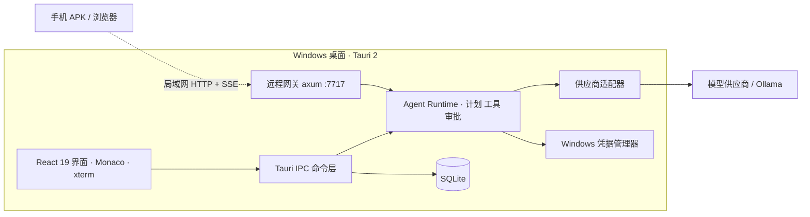

<p align="center">
  
</p>

<h1 align="center">BASALT · 玄武</h1>

<p align="center">
  <strong>面向 Windows 的本地优先 AI 工程工作台</strong><br />
  <sub>多模型对话 · 审批门控的编程 Agent · 真实终端 · 变更审查 · 图像生成 · 手机接管</sub>
</p>

<p align="center">
  
  
  
  
</p>

<p align="center">
  <a href="https://github.com/zakolinxi/basalt-workbench/releases/latest"><b>下载最新版</b></a>
  ·
  <a href="#安装">快速开始</a>
  ·
  <a href="#界面">界面</a>
  ·
  <a href="#技术架构">技术架构</a>
  ·
  <a href="#文档">文档</a>
</p>

<p align="center">
  
  <br />
  <sub>深色主题 · 玄武配色。左侧项目与会话，中间 Agent 时间线，右侧计划与变更，底部真实终端</sub>
</p>

## 定位

BASALT 把编程 Agent、多模型对话、真实终端、变更审查与图像生成放进同一个高密度界面，并让每一次文件写入和命令执行先经过你的审批。

项目、会话、变更快照和 API Key 都留在本机。离开这台机器的只有两样东西：你自己配置的供应商请求，以及 Agent 主动发起的联网工具。

四条取舍决定了它长成现在这样：

- **审批是主线，不是弹窗。** 目标 → 计划 → 工具调用 → 审批 → 修改 → Diff → 测试 → 报告，每一步都来自真实工具事件；失败和取消不会被写成成功。
- **不锁定模型。** OpenAI Chat / Responses、Anthropic、Gemini、Ollama 与 OpenAI 兼容网关走同一套适配层，切换供应商不改变 Agent 行为。
- **成本可核对。** 会话 token、缓存命中率、上下文占用与账户余额都在输入框下方，不用猜这一轮花了多少。
- **本地优先。** SQLite、附件、快照与密钥都在本机；Key 存在 Windows 凭据管理器，不写入数据库、配置文件或普通日志。

## 界面

<p align="center">
  
  
</p>

<p align="center">
  <sub>Agent 工具调用折叠为摘要行，测试保留 PASS / FAIL 与退出码 · 内置 PowerShell 占满宽度，xterm 自动适配</sub>
</p>

<p align="center">
  
  
</p>

<p align="center">
  <sub>供应商按协议与能力分开管理，Key 存进 Windows 凭据管理器 · 主题、配色、语言、字体与模型路由都在一处</sub>
</p>

<p align="center">
  
  
  
</p>

<p align="center">
  <sub>配对 → 工作台 → 会话与项目抽屉。手机连的是电脑上正在运行的那一个 BASALT，不是第二份数据</sub>
</p>

## 功能

### Agent 工作流

- **不设固定轮次上限。** 主 Agent 与子代理都可以一直工作到任务结束；随时可停，取消会终止当前请求与整棵命令进程树。
- **写入与命令默认要批准。** 危险命令、路径穿越、符号链接逃逸、项目外绝对路径由策略直接拒绝，审批也绕不过去。
- **只读子代理并行调查。** 可以同时派出多个子代理去看仓库、搜索和 Git，但它们不能写文件、不能执行命令、不能再开子代理。
- **计划和结果落在右侧面板。** TODO、代码变更、子代理任务树与完整报告固定在一列，不打断对话流。

### 变更与审查

- **写入前先留快照。** 每次修改都保留可审查、可撤销的旧内容；接受或撤销时用文件 hash 检测冲突。
- **Monaco 与 Git Diff。** 统一 / 并排两种视图，改动可以在会话里直接读完。
- **任务分支隔离。** Agent 任务可自动创建 `basalt/任务ID` 分支，跑完再决定是否合并。
- **Git 操作到位。** 提交全部变更、把单个已跟踪文件还原到 HEAD、提示未解决的合并冲突。

### 终端与工具

- **ConPTY 真实终端。** PowerShell / CMD / WSL 多标签，支持搜索、复制、清屏与结束进程树；用户终端与 Agent 命令分开标记来源。
- **工具集。** 列目录、搜索、读写、精确补丁、Git 状态与 Diff、PowerShell 命令、测试执行、联网搜索、网页读取。
- **测试结果内联。** PASS / FAIL、命令与退出码留在对话里，而不是只出现在某份日志中。

### 上下文 · 成本 · 模型

- **8 档思考强度。** `off` / `minimal` / `low` / `medium` / `high` / `xhigh` / `max` / `ultra`，按会话保存，并按协议映射到 OpenAI、Anthropic、Gemini、Ollama、DeepSeek、Kimi、GLM 与 MiniMax 的对应字段。
- **Token 与缓存可见。** 状态栏显示会话 token 总量、缓存命中率与上下文占用；展开可看缓存读取、未缓存输入、输出与系统提示明细。
- **余额 chip。** DeepSeek 与 Moonshot 官方账户直接显示总余额、赠送与充值构成；没有公开余额接口的兼容网关自动隐藏这一项。
- **接口自动探测。** 每个模型首次调用后按实测延迟在 Chat / Responses 之间选型并持久化，只探测一次。
- **故障处理。** 指数退避重试只在模型尚未输出文本时生效；可配置一次性降级供应商，重试与降级都写进任务时间线。

### 扩展：Skills / MCP / 插件

- **Skills。** 导入含 `SKILL.md` 的目录，系统提示只列名称与描述，匹配到任务时才按需读取全文。
- **MCP。** stdio 与 Streamable HTTP，自动发现工具、逐次审批，可查看 schema 并直接测试 `tools/call`。
- **插件包。** 一个 `plugin.json` 同时声明多个 Skill 与 MCP 服务器，卸载时一并清理。
- **统一工具注册表。** 内置工具、Skill 加载器与所有已启用的 MCP 工具集中显示来源、只读性与审批要求。

### 图像工作区

- **独立于聊天模型。** 图像生成与编辑各自有独立路由，`/img` 不要求当前对话模型支持生图。
- **能力由适配器声明。** OpenAI Images 与 Gemini Images 分别声明尺寸、质量、数量、参考图、蒙版与同步 / 异步能力；界面只展示真实支持的参数，服务端再校验一次。
- **历史留在工作区。** 生成记录支持预览、保存、重生成、继续编辑与复制提示词，文件落在应用数据目录的 `images/`。

### 手机接管与云端 Agent

- **扫码接管同一实例。** 同一 WiFi 下扫二维码或输入 6 位配对码；配对码 10 分钟有效，连错 6 次锁定 60 秒，令牌失效自动回到配对页。
- **不是精简版。** 会话、Agent、审批、Diff、终端、供应商、Skills / MCP、图像与设置都能在手机上用，因为它复用同一份界面、同一套命令、同一条事件流。
- **远程默认关闭。** 开启后只监听局域网（默认 `7717`），不内置任何公网穿透。
- **云端 Agent。** 可保存多台 SSH 服务器，在远程 Linux 上跑同一套工具；改动仍然进入 CHANGES / DIFF，可审查也可通过 SSH 撤销。密码认证需要系统装有 `sshpass`。

### 外观、语言与布局

- 简体中文 / English / 日本語 / 한국어 即时切换；深浅主题加 5 套整页配色（玄武 / 森林 / 薄荷 / 蜜蜂 / 羊皮纸）。
- 项目与会话侧栏：切换项目或添加目录，会话按项目归档；全局搜索可过滤会话、任务与已加载文件。
- 面板可拖拽折叠，布局与折叠状态持久化；窄屏自动切成抽屉式侧栏、底部导航与全屏终端。

## 模型与供应商

| 协议 | 端点 | 备注 |
| --- | --- | --- |
| OpenAI Chat Completions | `{base}/chat/completions` | 兼容网关最通用的接入方式 |
| OpenAI Responses | `{base}/responses` | 保留 Responses 的工具与事件语义，不经 Chat 中转 |
| Anthropic Messages | `{base}/messages` | 显式提示缓存；网关拒绝 `cache_control` 时自动无缓存重试 |
| Google Gemini | `{base}/models/{model}:generateContent` | 密钥走 header；工具调用合成稳定 ID |
| Ollama | `/api/chat` | NDJSON 流式，本地模型无需 API Key |
| OpenAI / Gemini Images | `/images/generations`、`/images/edits` | 图像路由独立于对话模型 |

- Base URL 只填域名即可，保存时自动补 `https://` 与版本路径（Gemini 补 `/v1beta`，本机地址补 `http://`）。
- 17 个预置模板：DeepSeek、MiniMax、Kimi、Qwen、GLM、Grok 等官方协议，加上兼容接口、自建网关与图像网关。
- 模型卡片用 10 项能力 × 5 种状态描述真实支持情况；测试连接成功只代表认证可用，能力仍要真实调用后才会转为已验证。

## 安装

### 系统要求

| 项目 | 要求 |
| --- | --- |
| 系统 | Windows 10 / 11 x64，需要 WebView2 Runtime |
| 运行 | 不需要 Node.js 或 Rust，下载即用 |
| 手机端 | Android，或任意现代浏览器（可添加到主屏幕当 PWA） |

### 下载

最新构建在 [Releases](https://github.com/zakolinxi/basalt-workbench/releases/latest)。文件名里的版本号与发布标签一致。

| 产物 | 说明 |
| --- | --- |
| `Basalt.exe` | 免安装，双击即用 |
| `Basalt_{version}_x64-setup.exe` | NSIS 安装包 |
| `Basalt-{version}-x64-portable.zip` | 便携包，含 README、LICENSE 与字体许可 |
| `Basalt-Remote-{version}.apk` | Android 手机客户端，固定 release 证书签名 |
| `SHA256SUMS.txt` | 全部产物的校验和 |

> [!WARNING]
> Windows 安装包尚未做代码签名，首次运行可能被 SmartScreen 拦下，需要手动选择「仍要运行」。可以先核对 `SHA256SUMS.txt`。手机端请保留签名证书备份：换证书后新包无法覆盖安装，只能先卸载。

### 首次启动

1. 打开「供应商」→ 从模板新建一个供应商，填入 API Key；本地 Ollama 可以不填。
2. 在模型卡片里确认上下文窗口与工具 / 视觉 / 思考能力，把默认对话模型指过去。
3. 添加一个本地项目目录。Agent 只在这个目录内读写。
4. 输入任务。Agent 会先给计划，然后在每次写文件和执行命令前请求你的批准。
5. 想用手机接管：设置 → 手机连接 → 打开开关 → 扫码。

## 从源码构建

需要 Windows 10 / 11 x64 + WebView2、Node.js ≥ 20、Rust stable（MSVC toolchain）与 Visual Studio Build Tools 的 C++ 工作负载；Git 用于 Diff、分支与 Git 状态。

```bash
npm install
npm run tauri dev      # 开发
npm run tauri build    # 产出 EXE 与 NSIS 安装包
```

Android 客户端需要 JDK 21、Android SDK Platform 35 与 Build-Tools 35：

```bash
npm run mobile:apk           # 调试包
npm run mobile:apk:release   # 正式包，读取 android/keystore.properties 签名
```

<details>
<summary><b>构建细节：签名、产物位置与前端复用</b></summary>

正式签名读取 `android/keystore.properties`，它指向 `~/.basalt/basalt-release.jks`，两个文件都不入库。产物位于 `android/app/build/outputs/apk/release/app-release.apk`。

前端产物只有一份：`src-tauri` 通过 `include_dir!` 把它嵌进 exe，远程网关直接从内存托管，所以电脑端不需要额外部署静态文件。

</details>

### 测试

```bash
npm test                                            # 25 项前端测试
cargo test --manifest-path src-tauri/Cargo.toml     # 90 项 Rust 测试通过，1 项依赖真实 SSH，默认忽略
```

验证记录、界面检查清单与已知缺陷见 [docs/TESTING.md](docs/TESTING.md)。

## 技术架构



三条边界是硬性的：界面不直接调供应商 HTTP，请求全部在 Rust 适配器里完成；Agent Runtime 只依赖规范化的流式事件与工具调用结构，不依赖任何供应商私有实现；图像路由独立于对话模型。

```text
src/                    React 19 + TypeScript 界面（桌面与手机共用）
  components/           聊天、任务、右侧面板、终端、输入框、目录浏览器
  views/                工作台、供应商、图像、扩展、设置、手机配对
  lib/bridge.ts         传输桥：桌面走 Tauri IPC，手机走 HTTP + SSE
src-tauri/              Tauri 2 + Rust
  src/agent/            Agent Runtime、工具、子代理、系统提示词
  src/providers/        Chat / Responses / Anthropic / Gemini / Ollama 适配器
  src/remote/           远程网关：axum 服务、配对鉴权、RPC 分发、SSE 事件流
  src/commands/         Tauri commands（同一套函数同时服务桌面与手机）
  src/db.rs             SQLite schema 与迁移
android/                Capacitor Android 工程
docs/                   功能、设计、手机连接、供应商、测试与截图
```

## 安全边界

- **API Key 不进数据库。** 存在 Windows 凭据管理器（service `com.basalt.workbench`），由 Rust 端读取并只注入请求头；余额查询也在后端完成。
- **文件工具被项目根锁住。** 只接受项目内相对路径，绝对路径、`..`、前缀组件与符号链接逃逸一律拒绝；`.git/` 与应用数据库不可写。
- **命令有硬拒绝清单。** 格式化磁盘、改注册表、`git reset --hard`、`git clean -fdx`、下载后直接执行、请求提权等操作不可通过审批绕过。
- **审批不是沙箱。** 被批准的命令拥有你的用户权限；审批加路径 / 命令策略才是这里的边界，没有操作系统级隔离。
- **局域网访问要先看到屏幕。** 6 位配对码只显示在这台电脑上，连续猜错 6 次锁定 60 秒；不内置公网穿透，如需外网请自行加 VPN 或反向代理，并清楚这意味着把整台工作台暴露出去。

## 路线与现状

**已完成**：工作台与 Agent 全链路、真实终端、Diff 与快照、供应商与能力矩阵、图像工作区、Skills / MCP / 插件、手机端接管、余额与缓存遥测。

**开发中 / 已知限制**：视觉模型独立路由已持久化但会话仍用选定模型；图像适配器均为同步接口，没有异步轮询与取消；终端标签不跨重启保留；MCP 只实现 `initialize`、`tools/list` 与 `tools/call`；一次只能带一张参考图。

**尚未验证**：真实供应商的流式对话、工具调用、视觉输入与图像生成没有在本机用真实 API Key 跑过端到端；协议实现与单元测试就绪，模板预置的能力标记统一为 `unverified`。

## FAQ

<details>
<summary><b>必须有 API Key 才能用吗？</b></summary>

对话、Agent 与图像都走你自己配置的供应商，应用不含内置额度或代付通道。本地 Ollama 模型可以不填 Key。

</details>

<details>
<summary><b>Base URL 到底填什么？</b></summary>

只填域名就行，例如 `api.deepseek.com`，保存时会自动补 `https://` 与 `/v1`；本机或局域网地址补 `http://`。粘贴完整端点也可以，会先裁掉端点再按协议补齐版本路径。

</details>

<details>
<summary><b>手机连不上怎么办？</b></summary>

先确认三件事：手机和电脑在同一 WiFi、Windows 防火墙允许了专用网络、设置里的开关是打开的。能打开页面但一直 401，说明配对码过期，点「换一个」重新配对。

</details>

<details>
<summary><b>Agent 能碰项目外的文件吗？</b></summary>

不能。文件工具只在添加项目时记录的 canonical root 内工作，绝对路径、路径穿越、符号链接逃逸与 `.git/` 写入都会被拒绝，而不是弹一个可以点「允许」的框。

</details>

<details>
<summary><b>模板里的供应商为什么不能直接开始对话？</b></summary>

模板只提供协议、Base URL 与模型目录的骨架，不含密钥。填上 Key、确认模型能力之后才能真正调用。

</details>

## 文档

| 文档 | 内容 |
| --- | --- |
| [FEATURES.md](docs/FEATURES.md) | 功能完成度、部分实现与未验证项 |
| [ARCHITECTURE.md](docs/ARCHITECTURE.md) | 模块划分、协议适配、Agent 状态机、事件总线 |
| [PROVIDERS.md](docs/PROVIDERS.md) | 供应商接入、Base URL 约定、能力矩阵、思考强度映射 |
| [MODEL_ROUTING.md](docs/MODEL_ROUTING.md) | 模型路由与接口自动探测 |
| [REMOTE.md](docs/REMOTE.md) | 手机连接、配对流程与排查 |
| [SKILLS.md](docs/SKILLS.md) | Skills 目录结构 |
| [SECURITY.md](docs/SECURITY.md) | 信任边界、拒绝清单与数据边界 |
| [TESTING.md](docs/TESTING.md) | 测试与界面验证记录 |

## English

**BASALT** is a local-first AI engineering workbench for Windows, built with Tauri 2, Rust, React 19 and SQLite. It puts a multi-provider chat, an approval-gated coding Agent, a real ConPTY terminal, change review and an image studio in one desktop app. Projects, sessions, snapshots and API keys stay on the machine; only requests to the providers you configure leave it.

Since 0.3.0 the desktop can be driven from your phone over the local network: pair with a 6-digit code or QR, then approve writes, read diffs and use the terminal from Android or a browser. The UI ships in Simplified Chinese, English, Japanese and Korean. Download from [Releases](https://github.com/zakolinxi/basalt-workbench/releases/latest).

## License & Credits

- 代码：[MIT License](LICENSE) © 2026 林汐音 (zakolinxi)。
- 字体：Inter 与 JetBrains Mono，SIL OFL 1.1，见 [src/assets/fonts/OFL.txt](src/assets/fonts/OFL.txt)。
- 应用图标由 `gpt-image-2.5-sunburst` 生成。
- and tksn [linuxdo](https://linux.do)
