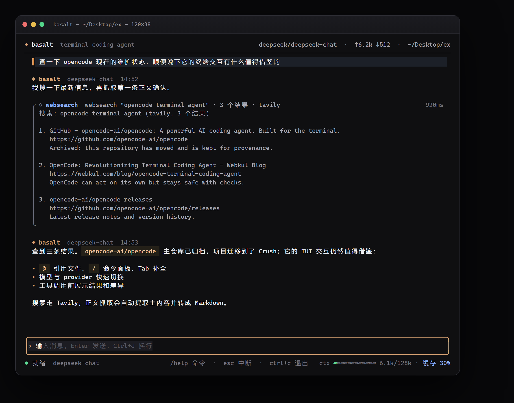

# Basalt TUI

**终端里的 Basalt 编程代理。** 读代码、改文件、跑测试，改动前先看 diff 再批准。

独立的 Go 单文件程序，不依赖桌面端或 Tauri。启动时直接复用 Basalt 工作台里已有的供应商、模型和 API Key —— 桌面版配过的，终端里不用再配一遍。


`Go 1.26+` · `Windows x64` · `MIT`

---

## 为什么用它

- **模型是现成的。** 直接读取 `basalt.db` 的 `providers` 表和 Windows 凭据管理器，供应商、模型列表、密钥全部就位；没有桌面版时回退到内置预设。
- **改动看得见、退得回。** 写文件前先算行级 diff 并请求批准；每次修改留快照，`/undo` 一键还原。
- **真的能联网。** `websearch` 支持 Tavily / Brave / SearXNG / DuckDuckGo，`webfetch` 自动提取正文、转 Markdown、批量抓取并缓存。
- **不是草稿级 TUI。** 思考可折叠、对话可滚动、上下文仪表常驻、供应商/模型用方向键选。

## 快速开始

### 从源码构建（最新功能）

```bash
git clone https://github.com/zakolinxi/basalt-workbench.git
cd basalt-workbench/basalt-tui
go build -trimpath -o bin/basalt.exe .
```

PowerShell：

```powershell
cd basalt-workbench\basalt-tui
go build -trimpath -o bin\basalt.exe .
.\bin\basalt.exe -C C:\path\to\project
```

### 预编译包

GitHub Releases 的 `tui-v*` 标签提供 `basalt-tui-windows-x64.exe`。预编译包可能落后于源码，想要最新功能请用上面的构建方式。

### 模型从哪来

1. 已安装 Basalt 桌面版：自动共用它的供应商与密钥，无需配置。
2. 没有桌面版：设置对应供应商的环境变量，或写一份 JSON 配置。

```powershell
$env:DEEPSEEK_API_KEY = "sk-..."
# 也支持 OPENAI_API_KEY / ANTHROPIC_API_KEY / MOONSHOT_API_KEY / ZHIPU_API_KEY / GEMINI_API_KEY
```

### 先看看界面

```bash
basalt.exe --demo
```

演示模式不需要 API Key，预置了一段完整对话，可以直接翻看。

### 常用参数

| 参数 | 作用 |
| --- | --- |
| `-C <dir>` | 指定工作区，默认当前目录 |
| `--provider <name>` | 启动时使用的供应商（id 或名称） |
| `--model <name>` | 覆盖模型 |
| `--demo` | 预置演示会话，不需要 Key |
| `--version` | 打印版本 |

## 界面一览

| 区域 | 内容 |
| --- | --- |
| 顶栏 | 品牌、当前供应商/模型、累计 token、工作区 |
| 对话区 | 用户消息、Markdown 回复、可折叠思考、工具卡片、diff |
| 输入框 | 多行编辑，`Enter` 发送、`Ctrl+J` 换行 |
| 底栏 | 运行状态、快捷键、上下文条与缓存命中率 |

工具卡片会展示调用参数、耗时和输出；写操作会展开 diff，危险操作先弹审批卡片。

## 核心能力

### 对话与模型


- 流式输出：OpenAI Chat Completions、OpenAI Responses、Anthropic Messages、Gemini、Ollama
- `/model` 打开交互式选择器：方向键选供应商和模型，输入过滤，`Enter` 切换
- 会话自动保存，`/sessions` / `/resume` 恢复，`/export` 导出 Markdown
- 超长会话自动压缩，`/compact` 手动触发

### 工具与审批

| 工具 | 用途 | 权限 |
| --- | --- | --- |
| `read` `list` `glob` `grep` | 读取与检索工作区 | 自动 |
| `write` `edit` | 新建、覆盖、精确替换 | 审批 |
| `bash` | 构建、测试、git 等命令 | 审批 |
| `websearch` | 搜索公开网页 | 自动 |
| `webfetch` | 抓取网页正文 | 审批 |
| `update_plan` | 提交执行计划 | 自动 |

审批卡片支持 `y` 允许一次、`a` 本会话总是允许、`n` 拒绝。拒绝会作为工具结果回给模型，不会卡住对话。

### 联网



- 搜索后端自动选择：Tavily → Brave → SearXNG → DuckDuckGo
- `fetchTop` 可自动抓取前 1–3 条结果的正文
- 正文提取会去掉导航、页脚和侧栏；HTML 转 Markdown 保留标题、列表、代码和链接
- 自动检测 GBK 等编码；页面缓存 10 分钟
- 回环、内网、链路本地、CGNAT、云元数据地址在解析和连接两处拦截

### 终端体验

- `Ctrl+T` 展开/收起思考，默认只留一行摘要
- 鼠标滚轮、`↑/↓`、`PgUp/PgDn` 浏览历史；离开底部后流式输出不会把视图拽回去
- 底栏右侧常驻上下文进度条：`已用/上限` 与缓存命中率，60%/85% 变黄/变红
- 真彩渐变、Markdown 渲染、语法高亮、diff 着色

<details>
<summary>更多截图</summary>

模型选择器：


改动审批：


命令面板：


任务完成：


</details>

## 命令与快捷键

| 命令 | 作用 |
| --- | --- |
| `/help` | 帮助与快捷键 |
| `/model` | 打开供应商 / 模型选择器 |
| `/new` | 新会话 |
| `/sessions` | 列出历史会话 |
| `/resume <id>` | 恢复会话 |
| `/compact` | 压缩上下文 |
| `/undo` | 撤销最近一次文件改动 |
| `/clear` | 清屏 |
| `/tools` | 查看工具 |
| `/cost` | token 用量 |
| `/init` | 生成 `BASALT.md` 项目说明 |
| `/export` | 导出会话 Markdown |
| `/quit` | 退出 |

**输入**：`Enter` 发送 · `Ctrl+J` 换行 · `Esc` 中断生成

**界面**：`Ctrl+T` 思考折叠 · `Ctrl+L` 清屏 · `Ctrl+P` 命令面板

**滚动**：鼠标滚轮 · `↑/↓` 一行 · `PgUp/PgDn` 翻页 · `End` 回到底部 · `Home` 到顶部 · `Alt+↑/↓` 输入历史

## 配置

### 共用 Basalt 工作台（默认）

- 供应商与模型：`%APPDATA%\com.basalt.workbench\basalt.db` 的 `providers` 表
- API Key：Windows 凭据管理器，条目为 `<provider-id>.com.basalt.workbench`
- 默认供应商：`--provider` → 工作台 `routing.chat` → TUI 上次选择 → 第一个可用项

`/model` 里带「工作台」标记的就是共享供应商。切换只记住 TUI 自己的默认项，不会改写桌面版数据库。

其他平台的数据目录：

- macOS：`~/Library/Application Support/com.basalt.workbench/basalt.db`
- Linux：`~/.local/share/com.basalt.workbench/basalt.db`

> 非 Windows 平台可以构建运行，但读不到 Windows 凭据，API Key 需要用 JSON 配置或环境变量提供。

### JSON 覆盖

按顺序查找，命中第一个即停止：

1. `$BASALT_TUI_CONFIG`
2. `<工作区>/.basalt/config.json`
3. `<UserConfigDir>/basalt-tui/config.json`

只写要覆盖的字段，其余继续沿用工作台的值：

```json
{
  "default": "DeepSeek",
  "providers": {
    "DeepSeek": {
      "model": "deepseek-reasoner",
      "maxTokens": 4096
    }
  }
}
```

完整示例见 [config.example.json](config.example.json)。没有工作台数据库时，TUI 回退到内置预设。

会话保存在 `<UserConfigDir>/basalt-tui/sessions/`，Windows 下是 `%APPDATA%\basalt-tui\sessions\`。

### 联网搜索

```powershell
$env:TAVILY_API_KEY = "tvly-..."
# 或 BRAVE_API_KEY / SEARXNG_URL
```

固定后端并调整超时与缓存：

```json
{
  "web": {
    "provider": "tavily",
    "tavilyKey": "${TAVILY_API_KEY}",
    "timeoutSeconds": 25,
    "cacheTtlSeconds": 600
  }
}
```

### 环境变量

| 变量 | 作用 |
| --- | --- |
| `BASALT_DB` | 指定 `basalt.db` 路径 |
| `BASALT_HOME` | 指定工作台数据目录 |
| `BASALT_TUI_CONFIG` | 指定 TUI 覆盖配置 |
| `BASALT_WEB_PROVIDER` | 固定搜索后端 |
| `TAVILY_API_KEY` / `BRAVE_API_KEY` / `SEARXNG_URL` | 搜索后端凭据 |
| `DEEPSEEK_API_KEY` 等 | 内置预设的模型密钥 |

### 支持的协议

`openai_chat`（任意 OpenAI 兼容端点）、`openai_responses`、`anthropic`、`gemini`、`ollama`。供应商的 `headers` 字段可以追加自定义请求头。

## 工作方式

1. 读取共享供应商与凭据，再加载工作区、Git 状态、浅层文件树，以及 `AGENTS.md` / `BASALT.md` / `CLAUDE.md` 作为系统提示。
2. 模型流式返回文本和工具调用；工具按顺序执行，结果回填后继续下一轮，最多 24 轮。
3. 只读工具直接执行；写文件和命令先算 diff 再请求批准。被拒绝的操作会作为工具结果返回给模型。
4. 每轮结束保存会话与用量；上下文过长时压缩较早的消息。

## 安全边界

- **工作区沙箱**：所有路径解析后必须位于工作区内，`../` 越界会被拒绝。
- **改前可见**：每次写操作先展示完整 diff，拒绝即不落盘；快照支持 `/undo`。
- **SSRF 防护**：抓取只允许公网 http(s)，回环、内网、链路本地、CGNAT、云元数据地址在 DNS 解析和实际拨号两处都会被拦截，重定向逐跳检查。
- **密钥不落盘**：API Key 只从 Windows 凭据管理器读取，不写入 TUI 配置或会话文件。
- **命令隔离**：`bash` 子进程会移除常见 API Key 环境变量。
- **抓取限制**：单页 4MB，二进制内容拒绝，缓存 10 分钟。

## 与 opencode、桌面版的关系

和 opencode 相似的是交互形态：终端 TUI、流式对话、工具循环、审批、模型快速切换。

不同的是定位：Basalt TUI 是 Basalt 工作台的终端延伸，重点是**和桌面版共用供应商与密钥**，以及围绕「读 → 改 → 验证」的紧凑闭环。

当前不做：MCP、LSP、多 agent 并行、插件系统、图片生成、Web 客户端。工具串行执行，单会话单 agent。

## 开发

```bash
go test ./...                                   # 单元 + 端到端测试
go run . --demo                                 # 交互演示
go run . --snapshot docs/screenshots -C ..      # 重新生成效果图（需要 Chrome/Edge）
go run . --version
```

目录：

```
basalt-tui/
  main.go                  CLI 入口、快照模式
  internal/
    agent/                 对话循环、审批、上下文压缩、系统提示
    basaltdb/              读取工作台的 SQLite 供应商表
    config/                工作台 DB + JSON 覆盖合并
    diff/                  行级 LCS diff
    llm/                   OpenAI / Responses / Anthropic / Gemini / Ollama
    secrets/               Windows 凭据管理器
    session/               会话持久化
    snapshot/              ANSI → HTML → PNG 截图
    tools/                 文件、搜索、shell、网页工具
    tui/                   Bubbletea 界面、主题、Markdown、演示场景
  docs/screenshots/        效果图
```

## License

MIT，与仓库根目录的 [LICENSE](../LICENSE) 一致。
