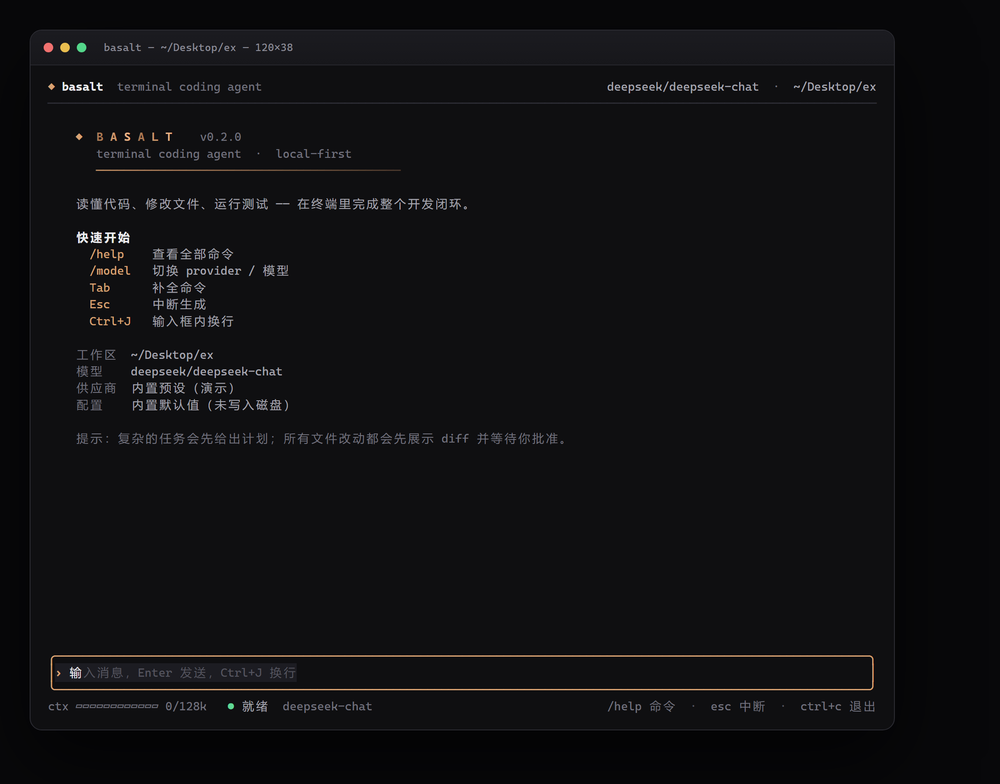
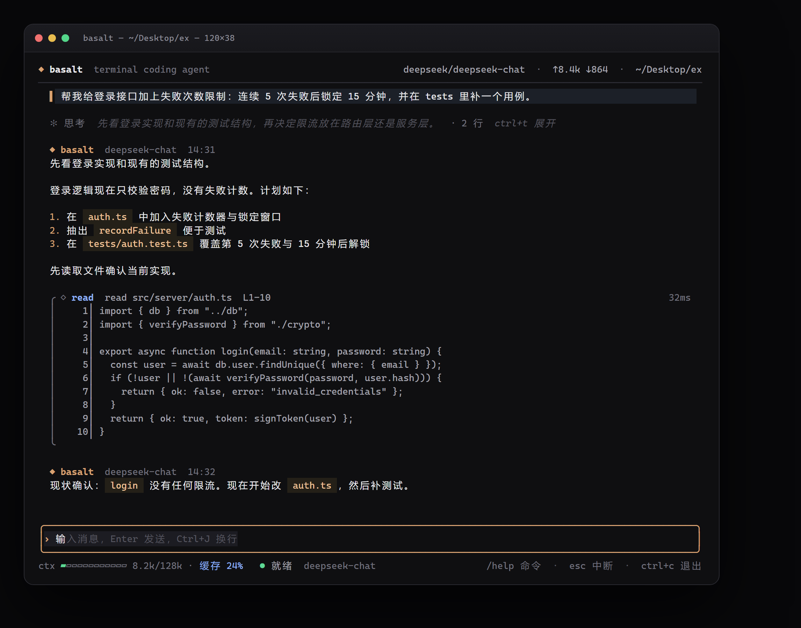
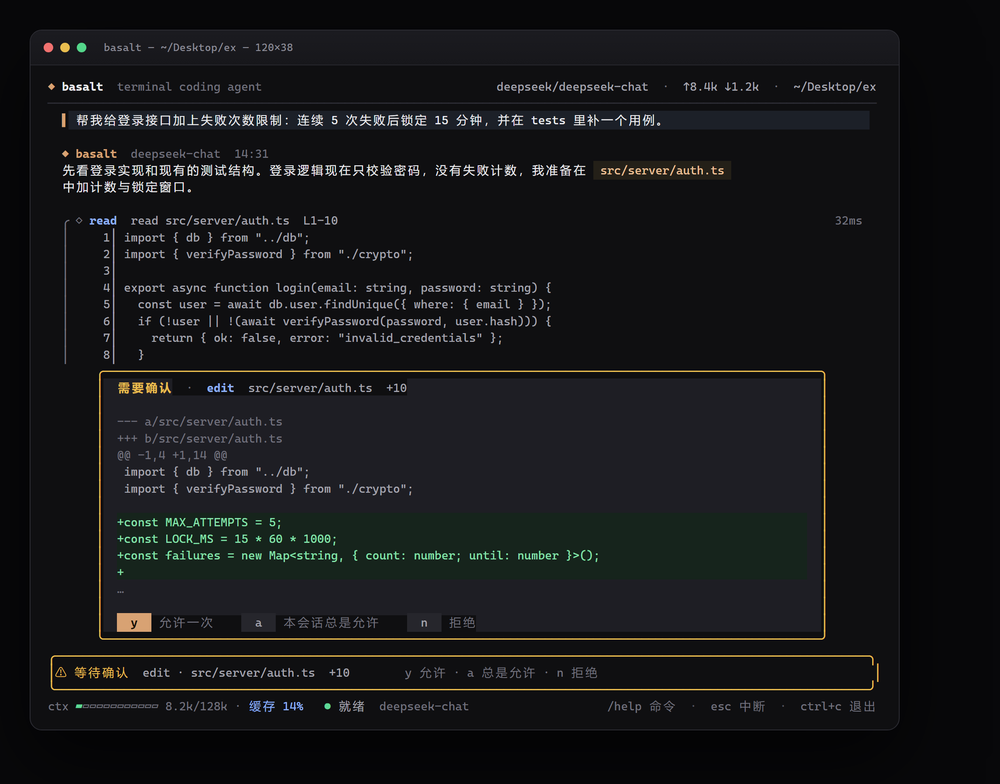
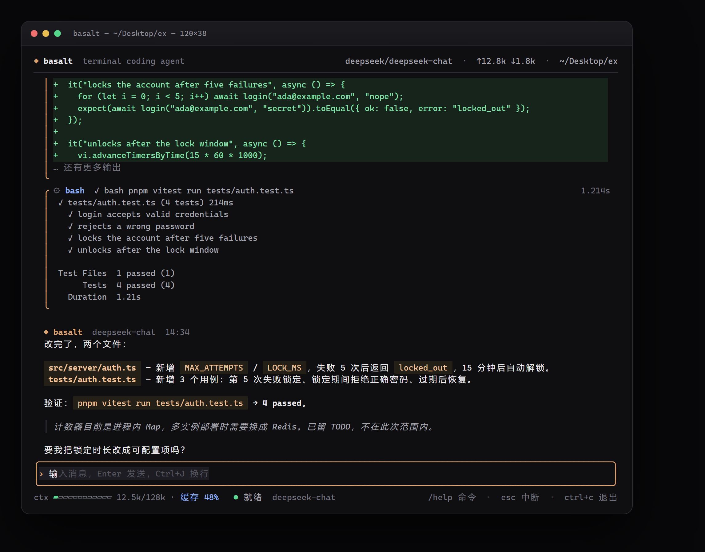
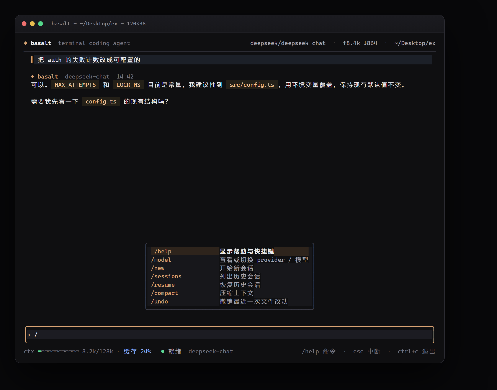
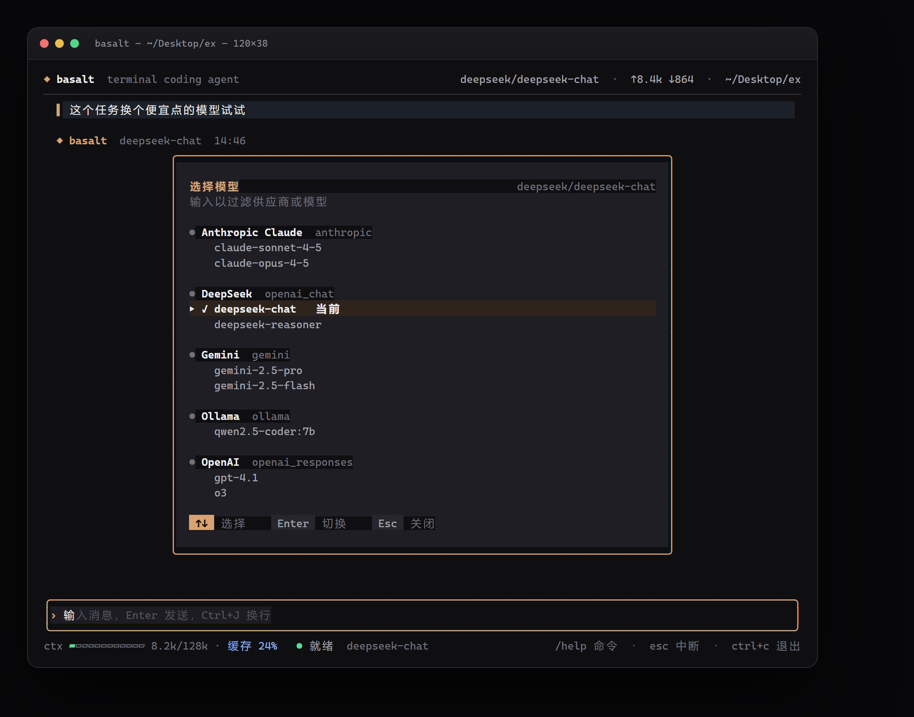

# Basalt TUI

在终端里完成整个开发闭环的编程代理 —— 读代码、改文件、跑测试，改动前先看 diff 再批准。

这是 [Basalt](../README.md) 的终端形态（`basalt-tui`）：独立的 Go 单文件可执行程序，不依赖桌面工作台，也不需要 Tauri。视觉与 Basalt 桌面版共用一套配色和交互约定。



## 效果

| 对话与工具调用 | 改动审批 |
| --- | --- |
|  |  |



命令面板与斜杠补全：



`/model` 交互式选择供应商与模型：



## 特性

- **与桌面工作台共用供应商**：直接读取 Basalt 的 `basalt.db` 和 Windows 凭据，桌面版配置过的 provider、模型和 API Key 在终端里立即可用，不需要再配一遍。
- **真流式对话**：OpenAI Chat Completions、OpenAI Responses、Anthropic Messages、Gemini、Ollama 原生协议，逐字输出，工具调用增量聚合。
- **思考可折叠**：推理内容默认收起成一行摘要，`Ctrl+T` 展开全文，再按一次收起。
- **上下文仪表**：底栏最左侧常驻上下文进度条、`已用/上限` 与缓存命中率，60%/85% 时变黄、变红。
- **对话可回看**：鼠标滚轮、`↑/↓`、`PgUp/PgDn` 浏览历史；离开底部后流式输出不会把视图拽回去，`End` 一键回到底部。
- **真实文件操作**：`read` / `write` / `edit` / `list` / `glob` / `grep` / `bash` / `webfetch` / `update_plan`，全部限制在工作区内。
- **改动可见、可撤销**：写入前生成行级 diff；每次修改保存快照，`/undo` 一键还原。
- **审批式执行**：写文件、执行命令、抓取网页前弹出确认卡片，支持 `y` 允许一次、`a` 本会话总是允许、`n` 拒绝。
- **多 provider 热切换**：`/model` 打开交互式选择器，方向键选供应商和模型，Enter 切换，支持输入过滤；也可 `/model DeepSeek deepseek-chat` 直接指定。
- **会话持久化**：自动保存到用户配置目录，`/sessions` / `/resume` 恢复；`/export` 导出 Markdown。
- **终端质感**：真彩渐变、Markdown 渲染、语法高亮、行内代码、diff 着色、自适应输入框与状态栏。
- **上下文管理**：超长会话自动压缩，`/compact` 手动触发。
- **零依赖演示**：`--demo` 直接进入预置会话，不需要 API Key。

## 快速开始

需要 Go 1.24+。

```bash
cd basalt-tui
go build -o bin/basalt.exe .

# 设置任意一个 provider 的环境变量
export DEEPSEEK_API_KEY=sk-...
# 或 OPENAI_API_KEY / ANTHROPIC_API_KEY / MOONSHOT_API_KEY / ZHIPU_API_KEY

./bin/basalt.exe
```

Windows PowerShell：

```powershell
$env:DEEPSEEK_API_KEY = "sk-..."
.\bin\basalt.exe -C C:\path\to\project
```

没有 Key 也可以先看界面：

```bash
./bin/basalt.exe --demo
```

## 配置

### 共用 Basalt 工作台（默认）

TUI 启动时会读取桌面版的数据库和凭据：

- 供应商与模型：`%APPDATA%\com.basalt.workbench\basalt.db` 的 `providers` 表
- API Key：Windows 凭据管理器，条目为 `<provider-id>.com.basalt.workbench`
- 默认供应商：`--provider` → 工作台的 `routing.chat` → TUI 上次选择 → 第一个可用项

`/model` 里带 `basalt` 标记的条目就是共享供应商。切换后 TUI 只记住自己的默认选择，不会改写桌面版数据库。

其他平台的数据目录：

- macOS：`~/Library/Application Support/com.basalt.workbench/basalt.db`
- Linux：`~/.local/share/com.basalt.workbench/basalt.db`

### 覆盖与独立使用

需要临时改模型或指向别的数据库时，按以下顺序查找 JSON 文件，命中第一个即停止：

1. `$BASALT_TUI_CONFIG`
2. `<工作区>/.basalt/config.json`
3. `<UserConfigDir>/basalt-tui/config.json`

JSON 里的字段会覆盖同名供应商，未写的字段（ID、BaseURL、Key）继续沿用工作台里的值。

```json
{
  "default": "DeepSeek",
  "providers": {
    "DeepSeek": {
      "model": "deepseek-reasoner",
      "maxTokens": 4096
    }
  }
}
```

没有工作台数据库时，TUI 回退到内置预设，行为与之前版本一致。

### 环境变量

| 变量 | 作用 |
| --- | --- |
| `BASALT_DB` | 指定 `basalt.db` 路径 |
| `BASALT_HOME` | 指定工作台数据目录 |
| `BASALT_TUI_CONFIG` | 指定 TUI 覆盖配置 |
| `DEEPSEEK_API_KEY` 等 | 内置预设的密钥回退 |

### 支持的协议

`openai_chat`（任意 OpenAI 兼容端点）、`openai_responses`、`anthropic`、`gemini`、`ollama`。`headers` 字段可以为供应商追加自定义请求头。

## 命令

| 命令 | 作用 |
| --- | --- |
| `/help` | 帮助与快捷键 |
| `/model` | 打开供应商 / 模型选择器 |
| `/new` | 新会话 |
| `/sessions` | 列出历史会话 |
| `/resume <id>` | 恢复会话 |
| `/compact` | 压缩上下文 |
| `/undo` | 撤销最近一次文件改动 |
| `/clear` | 清屏 |
| `/tools` | 查看工具 |
| `/cost` | token 用量 |
| `/init` | 生成 `BASALT.md` 项目说明 |
| `/export` | 导出会话 Markdown |
| `/quit` | 退出 |

快捷键：`Enter` 发送 · `Ctrl+J` 换行 · `Esc` 中断生成 · `Ctrl+T` 展开/收起思考 · `Ctrl+L` 清屏 · `Ctrl+P` 命令面板。

滚动：鼠标滚轮 · `↑/↓` 一行 · `PgUp/PgDn` 翻页 · `End` 回到底部 · `Home` 到顶部 · `Alt+↑/↓` 输入历史。

## 工作方式

1. 启动时读取工作台共享的供应商与凭据，再读取工作区、Git 状态、浅层文件树，以及 `AGENTS.md` / `BASALT.md` / `CLAUDE.md` 作为系统提示。
2. 模型流式返回文本与工具调用；工具按顺序执行，结果回填后继续下一轮，最多 24 轮。
3. 只读工具自动执行；写操作与命令先算 diff、再请求批准。拒绝会作为工具结果返回给模型。
4. 每轮结束保存会话与用量；上下文过长时压缩较早的消息。

## 目录结构

```
basalt-tui/
  main.go                  CLI 入口、快照模式
  internal/
    agent/                 对话循环、审批、上下文压缩、系统提示
    basaltdb/              读取桌面工作台的 SQLite 供应商表
    config/                配置合并（工作台 DB + JSON 覆盖）
    diff/                  行级 LCS diff
    llm/                   OpenAI / Responses / Anthropic / Gemini / Ollama 客户端
    secrets/               Windows 凭据管理器（API Key）
    session/               会话持久化
    snapshot/              ANSI → HTML → PNG 截图
    tools/                 文件、搜索、shell、计划、网页工具
    tui/                   Bubbletea 界面、主题、Markdown、演示场景
  docs/screenshots/        效果图
```

## 开发

```bash
go test ./...                                   # 单元 + 端到端测试（含 SSE 解析、工具执行）
go run . --demo                                 # 交互演示
go run . --snapshot docs/screenshots -C ..      # 重新生成效果图（需要 Chrome/Edge）
```

## 安全边界

- 所有路径解析后必须位于工作区内，`../` 越界会被拒绝。
- API Key 只从 Windows 凭据管理器读取，不写入 TUI 配置或会话文件。
- `bash` 子进程会移除常见 API Key 环境变量，避免误泄露。
- 网页抓取仅支持 `http(s)` GET，响应限制 2MB。
- 每次写操作前都能看到完整 diff，拒绝即不落盘。

## 与 opencode 的差异

这是面向 Basalt 工作流的精简实现，不是 opencode 的复刻：

- 没有 MCP、LSP、多 agent 并行、插件系统与 Web 客户端。
- 命令与工具集更小，聚焦「读 → 改 → 验证」主链路。
- 配置格式与 Basalt 桌面版不完全兼容，但配色、审批语义与提示词规则保持一致。

## License

MIT，与仓库根目录一致。
