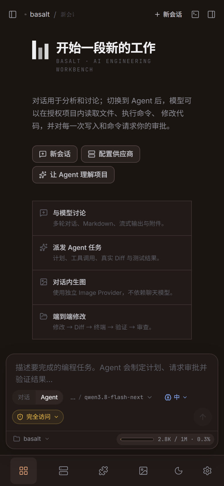

# 手机客户端

Basalt 的手机端不是把工作台搬进手机，而是**让手机遥控电脑上的这台 Basalt**。
项目、Git 仓库、API Key、SQLite、Agent 运行时、终端进程全部留在电脑上，
手机只负责发指令、看进度、点审批。

```text
┌────────────┐   配对码 → Bearer token   ┌──────────────────────────────┐
│  手机 APK   │ ─────────────────────────▶ │  电脑端 Basalt（远程网关）      │
│  或浏览器   │  POST /api/rpc  {cmd,args} │  axum :7717 → 原有 70+ 命令   │
│            │ ◀───────────────────────── │  GET  /api/events (SSE)      │
└────────────┘   与桌面窗口同一份事件流     └──────────────────────────────┘
```

## 一、电脑端开启

1. 打开 Basalt → **设置 → 手机连接**。
2. 打开「允许手机连接本机」。默认端口 `7717`。
3. 记下面板上显示的三样东西：**地址**（如 `192.168.1.8:7717`）、**6 位配对码**、二维码。

配对码 10 分钟有效，可随时点「换一个」。面板会显示当前已连接的设备数。

> 网关只监听局域网。首次开启时 Windows 防火墙可能弹窗询问，需要允许专用网络访问，
> 否则手机连不上。

## 二、手机端连接

三种方式，任选其一：

| 方式 | 步骤 | 特点 |
| --- | --- | --- |
| **扫码（推荐）** | 手机相机扫电脑上的二维码 | 直接打开配对页，配对码自动带入 |
| **浏览器** | 访问 `http://<地址>:7717`，输入配对码 | 零安装，可「添加到主屏幕」当 App 用 |
| **APK** | 安装 `Basalt-Remote.apk`，输入地址与配对码 | 原生全屏，无浏览器地址栏 |

配对成功后手机会记住这台电脑，下次打开直连。令牌失效（如在电脑端重装、清空数据）
时，手机自动回到配对页。

## 三、手机上能做什么



功能与桌面端一致——因为手机端复用了同一套界面与同一套后端命令：

- **会话与对话**：会话列表、流式回复、停止、重试、附件（从手机相册/文件选择后上传到电脑）。
- **Agent 任务**：任务树、TODO、子代理状态、工具调用时间线。
- **审批**：Agent 请求写入文件或执行命令时，手机上直接批准/拒绝。
- **变更审查**：Diff 查看、接受、还原；Git 状态、分支切换、提交。
- **终端**：真实 PowerShell / CMD / WSL，可输入与查看输出。
- **供应商 / 模型 / Skills / MCP / 插件 / 图像工作区 / 设置**：同样可改。
- **添加项目**：手机走的是**电脑端目录浏览器**（`browse_directories`），
  因为手机看不到电脑的磁盘。

桌面端专属的操作在手机上做了等效降级：

| 桌面 | 手机 |
| --- | --- |
| 原生文件对话框 | 手机自带文件选择器 → 上传字节 |
| 另存为（写到电脑磁盘） | 下载到手机 |
| 资源管理器打开路径 | 无（提示在电脑上操作） |
| 窗口按钮 / 拖动标题栏 | 隐藏 |

## 四、安全边界

- **默认关闭**，不开启就完全不监听端口。
- 配对必须先看到电脑屏幕上的 6 位码；连续猜错 6 次锁定 60 秒。
- 配对成功后才发放 32 字节随机令牌，存在电脑设置表里，手机存 localStorage。
- 所有 `/api/rpc` 与 `/api/events` 都要令牌；令牌错误直接 401，手机端随即清除本地配置。
- 只走局域网，不内置任何公网穿透。要在外网使用，请自行用 frp / Cloudflare Tunnel
  反代 `http://<电脑>:7717`，并注意：**反代到公网等于把整台工作台暴露出去**，
  建议只在可信网络下开启，或加一层 VPN。

## 五、自己构建

```bash
# 生产构建（桌面 exe 与手机构建共用同一份前端产物）
npm run build

# 同步到 Android 工程并打包调试 APK
npm run mobile:apk
# 产物：android/app/build/outputs/apk/debug/app-debug.apk
```

要求：JDK 21（`JAVA_HOME` 指向它）、Android SDK Platform 35、Build-Tools 35。

远程网关由 Rust 侧 `src-tauri/src/remote/` 提供，前端产物在编译时通过
`include_dir!` 内嵌进 exe，所以电脑端不需要额外部署静态文件。

## 六、排查

| 现象 | 原因 |
| --- | --- |
| 手机提示「无法连接该地址」 | 不在同一 WiFi / 防火墙拦截 / 开关没打开 |
| 面板显示端口无法监听 | 端口被占用，换一个（>1023）后重开开关 |
| 能打开页面但一直 401 | 配对码过期了，点「换一个」重新配对 |
| 事件不动，只有手动刷新有数据 | SSE 被代理缓冲了，检查是否经过 nginx（需关闭 proxy_buffering） |
